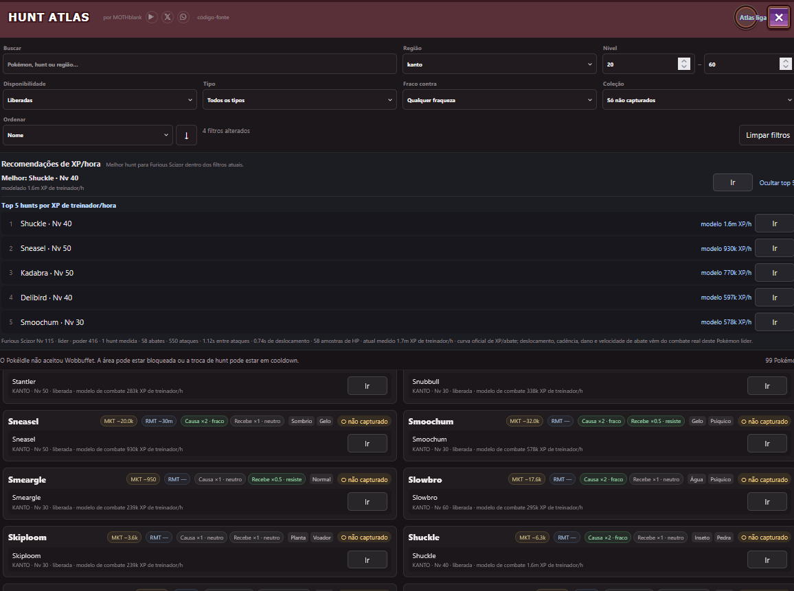

# PokéIdle Hunt Atlas

This directory contains the **one maintained Premium Hunt Atlas userscript**, its documentation, test suite and preview. The script replaces PokéIdle's **Map** view with a searchable hunt/Pokémon list. It is separate from the native Hunt Atlas in Moth Controller.

**Single install (v1.9.42):** [Install / update Hunt Atlas](https://raw.githubusercontent.com/MOTHblank/pokeidle-addons-premium/main/addons/hunt-atlas/hunt-atlas.user.js). This folder's `hunt-atlas.user.js` is the only version in this repository; it includes userscript-manager `@downloadURL` and `@updateURL` metadata. The old root-level script was removed. Existing installations of `addons/hunt-atlas.user.js` **must be replaced manually once**: remove or disable the old one, install the linked folder script, and leave only one Hunt Atlas enabled. Updating automatically from the now-deleted old URL is not possible.



## Português (Brasil)

### Instalação

1. Abra [**Instalar / atualizar Hunt Atlas**](https://raw.githubusercontent.com/MOTHblank/pokeidle-addons-premium/main/addons/hunt-atlas/hunt-atlas.user.js) no Violentmonkey ou Tampermonkey.
2. **Se já usa a versão antiga em `addons/hunt-atlas.user.js`, remova ou desative o script antigo e instale esta versão na pasta.** O endereço antigo não migra automaticamente.
3. Mantenha **apenas uma cópia** habilitada para evitar hooks WebSocket e Mapa duplicados.
4. Recarregue [PokéIdle](https://pokeidle.io/app) e abra **Mapa**.

Esta versão possui `@updateURL` e `@downloadURL` para atualizações automáticas enquanto o repositório permanecer público.

### Recursos

- **Top Catch — hunts comuns:** no Atlas, clique em **Iniciar** com o Auto Catch+ ativo. O modo percorre apenas hunts comuns de **uma espécie**, priorizando **capturas bem-sucedidas estimadas por hora** (chance de Ultra Ball × abates/h estimados pelo combate do Pokémon líder, ou medidos para a mesma configuração), **sempre com Ultra Ball** independentemente da prévia Ultra/Beast. Usa a mesma previsão da ordenação **Capturas/h** do Atlas, inclusive a fração de cadáveres realmente atingidos por arremessos quando houver amostras; o Auto Catch+ controla os arremessos reais. Hunts com projeção positiva e completa vêm primeiro; sem dados de combate, a chance por bola serve de alternativa, e combates comprovadamente impossíveis ficam por último. Empates usam a chance de captura, depois o nível. O primeiro alvo aguarda o carregamento dos dados de captura. Reavalia a hunt depois de 12 abates e 2 minutos de medidas reais, trocando caso outra opção tenha previsão superior em pelo menos 75%; sem essa evidência, permanece até uma captura confirmada pelo servidor e segue para a próxima. Hunts com múltiplas espécies, Safari e Arena Mística ficam fora do roteiro. Uma espécie só conta uma vez pela chave oficial da Pokédex (incluindo equivalências de Orre). Não consulta a Pokédex do jogador. O histórico semanal de espécies capturadas com bola é salvo no armazenamento local do navegador e restaurado após reiniciar o jogo, fechar a aba ou reconectar. O Atlas importa diretamente as espécies exibidas na lista oficial em **Pokédex → Top Catch** (`data-chave`), além de aproveitar o registro `{s,e}` se enviado pelo servidor. **Abra Pokédex → Top Catch uma vez por semana** antes de iniciar o roteiro, para confirmar as capturas já feitas em outras sessões. Se a lista oficial ainda não foi sincronizada, a automação aguarda em vez de repetir capturas. **Parar / Iniciar** não apaga o histórico, mesmo após concluir o roteiro. O registro zera na virada de domingo 00:00 (Brasília). **Troca rápida:** a automação usa os carimbos de 3 s de combate e 10 s de entrada enviados pelo servidor, aproveita aberturas entre ondas e verifica a oportunidade a cada 100 ms somente durante a troca de hunt. Se os golpes mantiverem a saída bloqueada depois da janela de entrada por mais tempo, usa **Desistir** (`centro.desistir`) como último recurso: isso nocauteia o Pokémon e **pode descontar 10% do XP do nível atual do treinador**. Ao confirmar a chegada ao Centro, usa a enfermeira (`centro.curar`), espera confirmação de cura e escolhe a próxima hunt. Parar a automação cancela novas ações. Capturas anteriores à instalação só podem ser recuperadas se o jogo disponibilizar o registro semanal oficial. O Atlas não arremessa bolas nem altera as configurações do Auto Catch+.
- Busca por Pokémon, hunt e região; filtros por nível, disponibilidade, tipos, fraquezas e capturados.
- Ordenação e Top 5 conforme o objetivo escolhido, com botão **Ir** para hunts disponíveis.
- XP/h por confronto, calculado a partir dos **stats e golpes do líder**, HP/defesas/tipos de cada inimigo, recargas e composição da hunt; não calibra inimigos diferentes a partir de outra batalha.
- Taxas medidas são salvas por **hunt + líder/nível/equipamento + escopo de bônus** e continuam disponíveis após sair. Se não houver dados suficientes para modelar, a taxa fica desconhecida, não um baseline idêntico a outros inimigos.
- As taxas de XP/h acima de 1 milhão agora exibem duas casas decimais. **sim. 1 golpe** avisa quando todos os combates amostrados pela simulação terminaram em um único golpe: neste limite, HP/defesa/tipo não diferenciam as hunts, mas movimentação, encontros e cura reais podem diferir. Não inventamos desempate sem dados.
- O modelo de combate foi portado do **Moth Controller**: simula os 32 IVs de HP selvagem, golpes e recargas persistentes, um ritmo genérico explícito entre alvos e o impacto de desmaios. A **bicicleta equipada entra apenas na parcela genérica de deslocamento**: Comum/Incomum/Rara/Mítica/Lendária dividem essa parcela pelos fatores 1,15/1,25/1,5/1,75/2, usando a tabela publicada pelo jogo quando disponível. Dano, recargas, movimento dos selvagens, retarget e espera de onda não são acelerados; trocar de bicicleta também separa as medições salvas para não reutilizar KPH de outra configuração. O Atlas **não usa mais coordenadas de `campo.init`, raios euclidianos, posições de spawn nem limite sintético de reposição por slot** para ordenar hunts. O cenário **combate em área** é opcional, desligado por padrão. Os golpes atuais acompanham o mesmo conjunto v1.408.7 do Controller (1.243 espécies/formas e 13.427 golpes). O HP modelado do Controller utiliza seu fator adicional ×12 e o multiplicador selvagem ×5; até existir calibração real por mapa, estimativas de movimentação continuam sendo aproximações e **medições reais da mesma hunt prevalecem**.
- Economia de farming: Moedas por abate, valor esperado dos drops NPC, receita confirmada e custos de reposição, sem misturar valores realizados e projetados.
- Comparação de Outland 1–8, previsões de drops raros e fragmentos, captura com Ultra/Beast Ball e estimativas de shiny.
- Bônus de XP detectados no estado do jogo separados das **simulações opcionais** de bônus de captura/drops.

Abra **Detalhes da hunt** para consultar fontes, cobertura e incertezas. O Atlas prioriza taxas medidas; previsões com dados faltando não são garantias. Fórmulas da wiki, drops e alguns campos do servidor ainda podem exigir validação no jogo. O experimento não compra bolas, não vende itens e não altera o Auto Catch+.

### Diagnóstico e testes

Para examinar um resumo local dos eventos de farming, execute no console:

```js
window.__mothHuntAtlasExperimentV1.snapshot()
```

Não há envio automático desse resumo. Funcionamento visual, precisão em jogo e consumo de CPU/RAM exigem observação em uma sessão real. Veja os [documentos técnicos](../../docs/README.md).

## English

### Installation

1. Open [**Install / update Hunt Atlas**](https://raw.githubusercontent.com/MOTHblank/pokeidle-addons-premium/main/addons/hunt-atlas/hunt-atlas.user.js) in Violentmonkey or Tampermonkey.
2. **If you installed the old `addons/hunt-atlas.user.js`, remove or disable it and install the folder version.** Its old feed does not redirect automatically.
3. Keep **only one Hunt Atlas copy** enabled to prevent duplicate map/WebSocket hooks.
4. Reload [PokéIdle](https://pokeidle.io/app) and open **Map**.

Automatic updates use the canonical folder URL while this repository remains public. If the repository becomes private again, the raw GitHub update feed will require an alternative distribution mechanism.

### Features and limits

**Top Catch for ordinary hunts:** Click **Start** with Auto Catch+ enabled. It visits **one-species ordinary hunts only**, prioritizing **estimated successful captures/hour** (Ultra Ball catch chance × kills/hour, using the lead Pokémon's combat projection or same-loadout observed kills/hour), **always assuming Ultra Ball** regardless of the Ultra/Beast preview. It uses the **same captures/hour formula as the Atlas sort**, including observed accepted-throw fraction when enough receipts exist; Auto Catch+ controls actual throws. Fully modeled, achievable rates come first; missing combat data falls back to per-ball odds, and confirmed unkillable targets come last. Catch chance then level break ties. The first target waits for the capture catalog to load. It also reviews an active hunt after at least 12 measured kills over 2 minutes and may switch if another hunt is predicted at least 75% better; otherwise it advances after a confirmed server capture. Ticket/multi-species hunts, Safari, and Mystic Arena are excluded. Species are deduplicated by the game's Pokédex key, without reading the player's Pokédex. The current week's ball-capture species list is persisted to browser local storage and restored after reloads, reconnects and Stop/Start (even after completion). Open **Pokédex → Top Catch once per week** to synchronize the game's actual captured-species cards (`data-chave`); explicit server `{s,e}` entries are also imported if available. Until the official weekly list is verified, automation waits instead of recatching earlier species. The ledger resets at Sunday 00:00 Brasília. **Fast travel:** after capture, the automation uses the game's 3-second combat lock and 10-second entry lock; it checks for a legal switch every 100 ms only while leaving a hunt, including between-wave openings. If repeated damage makes leaving impossible after the entry lock, it uses **Give Up** (`centro.desistir`) as a last resort, **knocking out the Pokémon and potentially losing 10% of the trainer XP within the current level**. It waits for the confirmed Center scene, asks Nurse Joy to heal (`centro.curar`), waits for healing acknowledgment and selects the next hunt. Stopping the automation cancels further actions. Historical captures predating installation are only recoverable when the game provides the official weekly list. Auto Catch+ handles all Pokéball throwing.

Hunt Atlas provides Pokémon/hunt/region search; filters for level, availability, type, weaknesses and collection; objective-specific sorting and Top 5 recommendations; and navigation to accessible hunts.

Its combat estimates derive from the lead Pokémon's combat stats, equipped/learnable moves, cooldown readiness and each enemy's own HP, defenses and types. **There is no cross-hunt correction factor.** A stable measured rate is retained after leaving, keyed to the exact hunt, lead/loadout/level and bonus scope; a new loadout or XP boost is a separate context. Missing combat inputs produce **unknown**, not a shared baseline. Models still approximate wild IVs, travel, healing, AoE and server AI; they are not guaranteed live rates.

Its detail panels distinguish **measured** from **modeled** trainer XP/hour, farming income and costs, Outland rare-drop estimates, Ultra/Beast catch and shiny projections, and detected XP bonuses versus hypothetical bonus simulations. Missing evidence remains unknown rather than being presented as a certain rate. The addon does not purchase supplies or change Auto Catch+.

High XP/hour values now retain two decimal places in millions to avoid false display ties. The **1-hit sim** marker means every sampled simulated fight ended in one hit: at that speed HP/defense/type cannot separate hunts, although actual travel, spawn timing, and recovery may still differ. We do not invent a ranking advantage when model inputs cannot justify one.

Combat projections now port the **Moth Controller native model**: all 32 wild HP IVs, persistent skill cooldowns, an explicit generic between-target pacing fallback, and survival/death downtime. The **equipped bicycle affects only that generic movement component**: Common/Uncommon/Rare/Mythic/Legendary divide it by 1.15/1.25/1.5/1.75/2, preferring the speed table published by the game when available. Damage, cooldowns, wild movement, retargeting and wave waits are unchanged, and changing bikes creates a separate measurement scope so KPH from another bike is not reused. Hunt ranking **no longer consumes `campo.init` coordinates, Euclidean entry radii, spawn positions, or a synthetic per-slot replenishment cap**. AoE remains an explicit optional scenario, off by default. Current move overrides match the Controller's v1.408.7 set (1,243 species/forms and 13,427 attacks). The controller's HP model applies its additional ×12 factor and wild ×5 multiplier. Until real map-paced calibration is available, movement remains approximate; exact same-hunt measured kills/hour take priority over the modeled estimate.

For local diagnostics, run `window.__mothHuntAtlasExperimentV1.snapshot()` in the browser console. Run model regression checks with `node --test addons/hunt-atlas/tests/rate-model.test.cjs`. Live-game/Firefox validation is still needed for performance and model accuracy. See the [technical references](../../docs/README.md).
