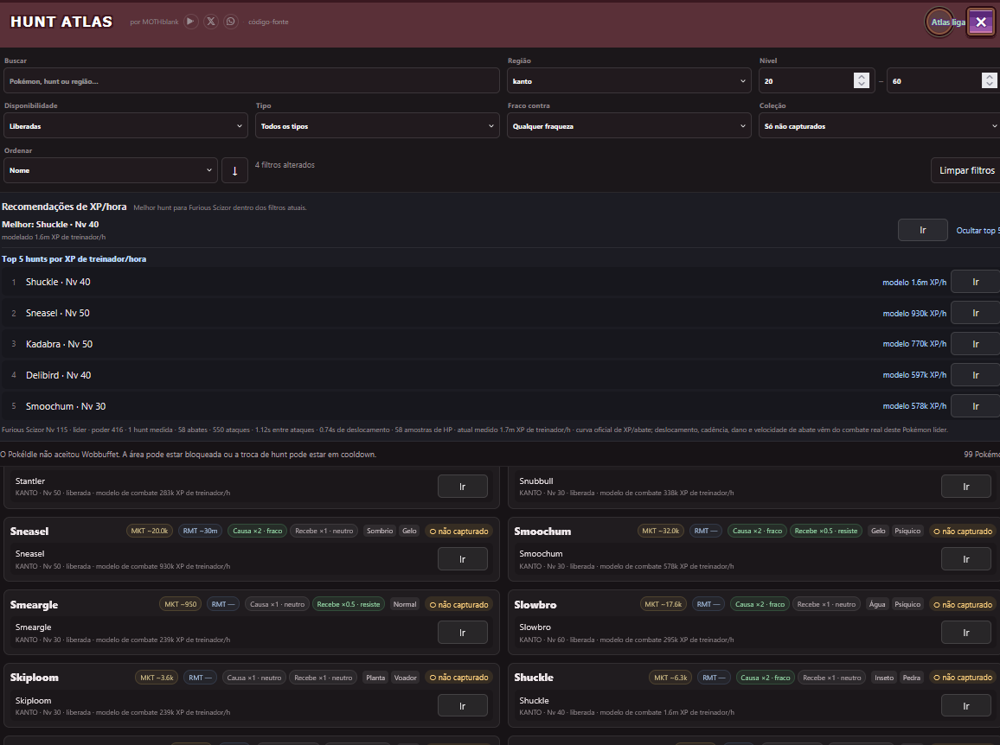

# PokéIdle Hunt Atlas (experimental)

This is the **premium experiment**, separate from the Hunt Atlas shipped through `pokeidle-addons`. Changes are not synchronized automatically. It replaces PokéIdle's **Map** view with a searchable hunt/Pokémon list—not a graphical map.



## Português (Brasil)

### Instalação

1. Entre no GitHub com acesso ao repositório privado e abra [hunt-atlas.user.js](hunt-atlas.user.js).
2. Copie o código para um novo script do Violentmonkey ou Tampermonkey.
3. **Desative qualquer outra cópia do Hunt Atlas** neste perfil para evitar conflito com o mapa e os hooks do jogo.
4. Recarregue [PokéIdle](https://pokeidle.io/app) e abra **Mapa**.

A instalação e as atualizações são **manuais**: o repositório privado não oferece atualização automática autenticada para o gerenciador de userscripts.

### Recursos

- Busca por Pokémon, hunt e região; filtros por nível, disponibilidade, tipos, fraquezas e capturados.
- Ordenação e Top 5 conforme o objetivo escolhido, com botão **Ir** para hunts disponíveis.
- XP/h por confronto, calculado a partir dos **stats e golpes do líder**, HP/defesas/tipos de cada inimigo, recargas e composição da hunt; não calibra inimigos diferentes a partir de outra batalha.
- Taxas medidas são salvas por **hunt + líder/nível/equipamento + escopo de bônus** e continuam disponíveis após sair. Se não houver dados suficientes para modelar, a taxa fica desconhecida, não um baseline idêntico a outros inimigos.
- As taxas de XP/h acima de 1 milhão agora exibem duas casas decimais. **sim. 1 golpe** avisa quando todos os combates amostrados pela simulação terminaram em um único golpe: neste limite, HP/defesa/tipo não diferenciam as hunts, mas movimentação, encontros e cura reais podem diferir. Não inventamos desempate sem dados.
- O modelo de combate considera os **IVs neutros estimados dos selvagens** (a fórmula oficial inclui `base + 2×IV`), prefere HP real de spawns medido na **mesma hunt / espécie / nível**, e testa várias ondas sem contar a primeira rodada de golpes imediatamente prontos. O selo de **golpes por abate** junto ao XP/h e o tooltip com a porcentagem de Investida mostram se o ultimate está realmente limitado pelo cooldown. Esses números simulados são aproximações, não medições do servidor.
- Economia de farming: Moedas por abate, valor esperado dos drops NPC, receita confirmada e custos de reposição, sem misturar valores realizados e projetados.
- Comparação de Outland 1–8, previsões de drops raros e fragmentos, captura com Ultra/Beast Ball e estimativas de shiny.
- Bônus de XP detectados no estado do jogo separados das **simulações opcionais** de bônus de captura/drops.

Abra **Detalhes da hunt** para consultar fontes, cobertura e incertezas. O Atlas prioriza taxas medidas; previsões com dados faltando não são garantias. Fórmulas da wiki, drops e alguns campos do servidor ainda podem exigir validação no jogo. O experimento não compra bolas, não vende itens e não altera o Auto Catch+.

### Diagnóstico e testes

Para examinar um resumo local dos eventos de farming, execute no console:

```js
window.__mothHuntAtlasExperimentV1.snapshot()
```

Não há envio automático desse resumo. Funcionamento visual, precisão em jogo e consumo de CPU/RAM exigem observação em uma sessão real. Veja os [documentos técnicos](../../docs/README.md).

## English

### Installation

1. Sign into GitHub with access to this private repository and open [hunt-atlas.user.js](hunt-atlas.user.js).
2. Copy its source into a new Violentmonkey or Tampermonkey userscript.
3. **Disable any other Hunt Atlas copy** in the same profile to avoid duplicate map/WebSocket hooks.
4. Reload [PokéIdle](https://pokeidle.io/app) and open **Map**.

Updates are manual; private repository files are not a reliable unauthenticated userscript update feed.

### Features and limits

Hunt Atlas provides Pokémon/hunt/region search; filters for level, availability, type, weaknesses and collection; objective-specific sorting and Top 5 recommendations; and navigation to accessible hunts.

Its combat estimates derive from the lead Pokémon's combat stats, equipped/learnable moves, cooldown readiness and each enemy's own HP, defenses and types. **There is no cross-hunt correction factor.** A stable measured rate is retained after leaving, keyed to the exact hunt, lead/loadout/level and bonus scope; a new loadout or XP boost is a separate context. Missing combat inputs produce **unknown**, not a shared baseline. Models still approximate wild IVs, travel, healing, AoE and server AI; they are not guaranteed live rates.

Its detail panels distinguish **measured** from **modeled** trainer XP/hour, farming income and costs, Outland rare-drop estimates, Ultra/Beast catch and shiny projections, and detected XP bonuses versus hypothetical bonus simulations. Missing evidence remains unknown rather than being presented as a certain rate. The addon does not purchase supplies or change Auto Catch+.

High XP/hour values now retain two decimal places in millions to avoid false display ties. The **1-hit sim** marker means every sampled simulated fight ended in one hit: at that speed HP/defense/type cannot separate hunts, although actual travel, spawn timing, and recovery may still differ. We do not invent a ranking advantage when model inputs cannot justify one.

Combat modeling now includes an **assumed neutral wild IV** (the stat formula uses `base + 2×IV`, not base alone), prefers spawn HP recorded for the exact same hunt/species/level, and simulates multiple interleaved waves while excluding the initial all-skills-ready burst. The per-kill **hits** indicator and its basic-attack-share tooltip make it easier to spot unrealistic ultimate spam or different matchup difficulty. Wild IV/quality, move readiness, actual enemy AI, pathing and sustain remain approximations until verified against battle events.

For local diagnostics, run `window.__mothHuntAtlasExperimentV1.snapshot()` in the browser console. Run model regression checks with `node --test addons/hunt-atlas/tests/rate-model.test.cjs`. Live-game/Firefox validation is still needed for performance and model accuracy. See the [technical references](../../docs/README.md).
