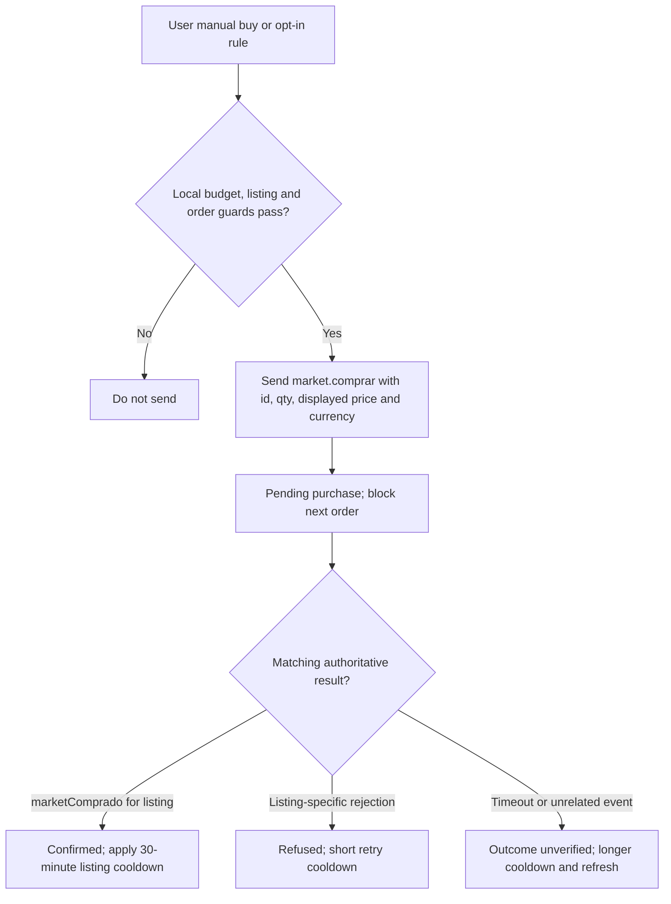

# Community Market protocol, fees and automation — wiki ↔ upstream ↔ Moth Watch

> **Implementation and maintenance reference for Moth Watch** (`addons/market-bot.user.js`), focused on *real Community Market* requests/responses, transaction safety and economic meaning. This is a **description of existing behavior and proposed validation**, **not a new API**, an invitation to bypass server restrictions, or an automatic trading strategy.
>
> **Reviewed:** 2026-10-13 · **Addon inspected:** premium **Moth Watch v0.3.1**. Live server packet shapes and settlement semantics are still **UNVERIFIED**. For synthetic protocol data and regression coverage, see the [market fixture](../tests/fixtures/moth-watch-market-protocol.json) and [automation tests](../tests/moth-watch-automation.test.cjs). Historical v0.2.1 descriptions are explicitly labeled below.

## Scope, trust model and linked sources

**[WIKI]** The owner's supplied complete PokéIdle wiki, especially *Mercado da Comunidade* and *Todas as taxas*, describes stated game/server rules. **[UPSTREAM]** Inspectable shared/client code in [`pokeidle-upstream`](https://github.com/MOTHblank/pokeidle-upstream) validates a subset, including the seller-fee helper, Pokémon listing eligibility, price-table window and NPC-sale exclusions. **[ADDON]** The current [premium Moth Watch userscript](../addons/market-bot.user.js) establishes exact outbound JSON it sends, the inbound fields it currently parses, its local state/cadence and safety guards.

**Limit of evidence:** the accessible upstream mirror does **not** contain the complete authoritative `server/market-db.mjs`, server-side `market.comprar` dispatch and database transaction/lottery implementation. Do not infer its complete packet schema or transaction atomicity from comments or the userscript alone. Use **[UNVERIFIED]** where live/server validation is necessary. Packet examples below are **observed source usage** or explicitly labeled *shape excerpts*, **not invented exhaustive schemas**.

Related: [Pokémon valuation](./POKEMON_VALUATION_REFERENCE.md), [Hunt rewards and rare drops](./HUNT_REWARDS_AND_RARE_LOOT.md), [Wiki/upstream mechanics map](./POKEIDLE_WIKI_UPSTREAM_MECHANICS_MAP.md).

## 1. Three currencies, two markets, and one unit price

| Identifier or product | Meaning | How Moth Watch treats it |
| --- | --- | --- |
| `gold` | **Coins** (Ouro), earned/used in the game | `moeda:'gold'`, `estado.gold`, reserve `goldReserve`, optional cap `maxCoinsPerBuy` |
| `orb` | **Gems** (Gemas), the Community Market's separate currency | `moeda:'orb'`, `estado.orbs`, reserve `gemReserve`, cap `maxGemsPerBuy` |
| Diamonds | Shop currency (Diamantes), and a *tradeable market asset* only when eligible | `tipo:'diamante'` for market listings, with **price in Coins or Gems**; never `moeda:'diamond'` |
| NPC `Market` | NPC purchases/sales of balls, potions, certain loot | Different API/economy: **not** Moth Watch's Community Market |
| Community Market / `RMT` | Players trading items, Pokémon and eligible Diamonds | Listing IDs, retention, purchase acknowledgements, tax, completed sales |

**[WIKI]** Community Market `preco` is **per unit**. A `qtd=20` lot at `preco=30_000` is a **600,000-Coin** full-lot purchase if all 20 are bought. A Pokémon is indivisible and bought as one specimen. A Diamond lot is also priced **per Diamond**. Never confuse **Gem-priced listings** with **Diamonds listed as the item**.

**[WIKI]** The buyer pays listing gross amount. Seller fees are removed from proceeds; **do not add a seller commission to the buyer's offered `preco`**. NPC item sale prices are not Community Market sale prices.

## 2. Outbound WebSocket request inventory — verified in premium addon

**[ADDON]** Requests are sent on the already-authenticated game WebSocket, using `socket.send(JSON.stringify(payload))`. Moth Watch observes the game's socket; it does not independently log in or use a third-party market REST API. Its actual outbound market packet families are:

| `t` | Payload fields used by Moth Watch | Purpose | Matching response |
| --- | --- | --- | --- |
| `market.itens` | `{t}` | Global per-item summary and price averages | `{t:'market',aba:'itens',resumo,medias}` |
| `market.item` | `{t,itemId,moeda}` | All current offers for an item and currency | `{t:'market',aba:'item',itemId,moeda,linhas}` |
| `market.listar` | `{t,tipo,moeda,ordem,pagina,...filtros}` | Browse Pokémon or Diamond offers (ordinary scan page **0**, Pokémon buying scan up to **3** pages) | `{t:'market',aba:'vitrine',linhas,...}` |
| `market.historicoGlobal` | `{t,pagina,tipo:'pokemon',moeda}` | Completed Pokémon sale history by currency | `{t:'market',aba:'historicoGlobal',linhas,temMais}` |
| `market.comprar` | `{t,id,qtd,preco,moeda}` | **Attempt** to purchase a specific listing at a protected unit price | Relevant `batalha.ev[k:'marketComprado']` on success; listing-specific `erro` or timeout otherwise |

**These exact requests are in** [`addons/market-bot.user.js`](../addons/market-bot.user.js). The addon does **not** send `market.criar`, sell/cancel/edit packets or bulk-buy requests. Native game trading UI may send additional commands that are **not part of this verified addon contract**; do not invent their names or payloads in code based on this document.

### 2.1 Small, source-backed request examples

```js
// Summary: server-calculated, recent, per-item market references
{ t: 'market.itens' }

// Item detail: one item + one currency
{ t: 'market.item', itemId: 106, moeda: 'gold' }

// Pokémon history: one currency/page, not all history in one request
{ t: 'market.historicoGlobal', pagina: 0, tipo: 'pokemon', moeda: 'orb' }

// Purchase attempt: price ceiling supplied from the listing the user saw
{ t: 'market.comprar', id: 12345, qtd: 3, preco: 30000, moeda: 'gold' }
```

The values `106` and `12345` are **illustrative IDs**, not live currently available item/listing IDs. **Never submit illustrative requests to a live market.**

For Pokémon scans the addon sends `market.listar` with `tipo:'pokemon'`, `moeda:'gold'|'orb'`, `ordem:'recentes'` for reference-only discovery or `ordem:'baratos'` with active purchase rules, and `pagina:0..2` (bounded), `especieId:0` and neutral values for `busca`, `criterios`, `elemento`, `categoria`, `soShiny`, `soP5`, `soTmElemental`, `soTmAoe`, `semOutland`, and level/potency/IV/quality/grade ranges. Diamond scanning uses `tipo:'diamante'`, `ordem:'baratos'`, the same neutral filters and `pagina:0`. The complete optional `market.listar` request contract and all server-side filter aliases are **not verified**.

### 2.2 Inbound envelope excerpts

```js
// Source-consumed fields, not exhaustive definitions
{ t: 'welcome', estado: { nick, gold, orbs, servidorAgora }, mercado: { catalogo: [] } }
{ t: 'estado', estado: { gold, orbs, servidorAgora /* perhaps more */ } }
{ t: 'market', aba: 'itens', resumo: {}, medias: {} }
{ t: 'market', aba: 'item', itemId, moeda: 'orb', linhas: [] }
{ t: 'market', aba: 'historicoGlobal', linhas: [], temMais: false }
{ t: 'market', aba: 'vitrine', tipo: 'pokemon', linhas: [], pagina: 0 }
{ t: 'batalha', ev: [{ k: 'marketComprado', listingId /* or an equivalent referenced ID */ }] }
{ t: 'erro', listingId /* when present */, chave /* or msg/message */ }
```

The source parser accepts aliases on **purchase acknowledgement**: `listingId`, `anuncioId`, `vendaId`, `anuncio.id` or `listing.id`. An error is associated with a pending purchase only when an explicit ID (`listingId`, `anuncioId` or `vendaId`) matches. Unrelated errors must **not** close an order.

**[ADDON]** A valid `welcome`, `market` or `batalha` packet can identify the correct game socket among several page WebSockets. `estado.servidorAgora` estimates server clock offset; a local wall-clock guess should not replace a server-provided retention deadline.

## 3. Listing identity, status, retention and release lottery

**[WIKI — Retenção e sorteio]** A newly published listing is immediately visible but **not purchasable for two minutes**. Adding units restarts the hold. Editing price is allowed after hold and restarts the hold. Cancellation is allowed during hold. Purchases in the first **three seconds after release** enter a fair lottery (**one entry per player per listing**); sending the packet earlier within that period gives no extra weight. Beyond that three-second window, the server processes otherwise eligible orders normally.

**[ADDON]** For listings `linhas[]`, observed fields used are `id`, `preco`, `qtd`, `vendedor` and `compravelEm` (server timestamp). Candidate IDs are keyed by market kind/currency/listing ID. `retentionUntil(listing)` returns future `compravelEm` when still held; a timer wakes the candidate **500 ms after the server-side nominal deadline**. The timer **does not** itself bypass or settle a lottery. The server remains the sole authority for availability and winning.

**Important implementation invariants:**

- Retained offers remain **visible** in Watch, but do not qualify as already-buyable.
- The first page can evict a retained listing from the scan even before release; the addon preserves a locally seen candidate until its release timestamp for awareness, but it **must not assume it remains available**.
- A newer hold (from seller adding stock or repricing) supersedes an older local release timer. Do not send based on an obsolete timestamp.
- **[UNVERIFIED]** Exact response shape for lottery registration, win/loss, and refund is not present in the shared upstream mirror. The wiki says losers are not charged; no addon should credit/debit based on prediction alone.
- No amount of clock precision or high-frequency polling legitimately improves probability **inside** a server-randomized three-second window.

### 3.1 Seller limits and item lifetime

**[WIKI]**
- Up to **20 open listings** simultaneously, with one item listing per item type; edit an existing item listing rather than stacking parallel undercuts.
- After item listing is sold or cancelled, that item has a **30-minute re-listing wait**.
- Pokémon listings are unique specimens; paid holding fee **100,000 Coins/day** for **1–30 days**, paid upfront; early sale does not refund days. A listing that expires returns Pokémon to the Depot. Extending incurs additional days and preserves the listing identity.
- Ordinary item listings carry **no daily holding fee** or expiry.
- One Diamond lot at a time and a **30-minute** wait between it and the next; listing removes eligible Diamonds from the balance up front; cancellation returns remaining units.
- Listing *escrows* the advertised quantity or Pokémon immediately. A seller cannot treat that inventory as still in hand.
- A Pokémon bought on RMT arrives in **Collection**, protecting it from routine NPC bulk-sale.

These are game rules, **not permissions for Moth Watch to sell**; auto-selling and `market.criar` were intentionally removed from premium Moth Watch.

## 4. Buy semantics: partial lots, price protection and transaction certainty

**[WIKI]**
- Item and Diamond listings can be partially bought. A seller's `preco` denotes **unit price**.
- Pokémon are whole, indivisible units; `qtd=1` in ordinary purchase semantics.
- The client sends the **displayed unit price** and currency. If the seller raises the price or changes currency before the server processes the purchase, it should refuse rather than pay more. If seller lowers the price, buyer pays the lower price.
- A bulk-price quotation can span up to **500 listings**, with bounded total units/max unit price; **that is a separate native market feature**. The premium addon uses specific `market.comprar` listing orders, not this bulk-buy flow.
- A lottery loss does not charge Coins/Gems according to wiki. No click, send result, or local balance delta is authoritative proof of success.

### 4.1 What Moth Watch sends and validates before a manual or rule buy

**[ADDON]** `tryBuy()` sends one `market.comprar` with:
- Exact positive **listing `id`** and `moeda:'gold'|'orb'`.
- Positive integer **`qtd`**, at most `listing.qtd` and the affordable quantity.
- **`preco`** = candidate's *current known unit price*, never average/reference price. A percentage discount display is **not** an authorization to pay more.
- A single global **`state.pendingBuy`**: another purchase cannot be sent until its outcome is handled or marked unknown.
- A short **attempted-listing cooldown** to avoid loops and duplicates.

The manually exposed Controller bridge `buyFromController(request)` may handle an item it has not scanned, but still validates ID, price, currency, quantity, available balance, reserves, per-order cap, pending orders and repeated attempts. It rejects known shiny Pokémon offered for Coins; when Pokémon metadata is absent, **the authoritative server must decide**. The returned `ok:true` on sending **means sent**, not completed.

### 4.2 The purchase state machine



**[ADDON v0.3.1]** A matching `batalha.ev[k:'marketComprado']` is the **only buyer-side success confirmation**. A five-second timeout, loss of socket, or page reload leaves the attempt **unknown** in an account-profile-local journal; its quoted maximum spend remains reserved against cumulative budgets. The same listing is protected **without an automatic retry deadline** until matching authoritative evidence arrives. A balance change alone does not settle an order.

On a confirmed buy, the addon prevents repeated buying from the same partially filled listing for **30 minutes**; a matched rejection applies a **5-second** cooldown. An initial attempt guard lasts **15 seconds**. Once marked unknown, the offer stays blocked across refresh/reconnect; a matching late acknowledgement/refusal can settle the journal record. An acknowledgement without authoritative execution details proves success but does **not** establish executed unit price or partial quantity, so spending exposure conservatively uses the **submitted upper-bound quote**.

**Implementation requirement:** do not cancel pending orders based solely on unrelated `erro` packets or `estado` balance changes. Do not resend because an ack was delayed or a WebSocket disconnected. Resolve uncertain outcomes by refreshed inventory/orders/history before further spending; the server is the source of truth, not the userscript's timer.

**[UNVERIFIED]** Exactly-once transactional behavior, server-side idempotency keys and response acknowledgements for native bulk orders are not evidenced. Do not assume `market.comprar` is idempotent across repeated identical sends.

## 5. Coin/Gem budget guards and automatic-buy opt-in

**[ADDON v0.3.1]** New-profile defaults (v0.2.1 had only item rules):
- `enabled: true` (**Watch itself is on**), `scanItems/scanPokemon/scanDiamonds: true`, `scanSeconds: 5`.
- `fixedRulesEnabled: false` and empty `fixedItemRules`, `anyItemRules`, `pokemonBuyRules`. **No purchases occur automatically by default.**
- `goldReserve: 0`, `gemReserve: 0`, `maxCoinsPerBuy: 0`, `maxGemsPerBuy: 0`.
- `purchasesPaused: false`, and **all cumulative spend, count and quantity caps default to zero (unlimited)**. A rule must still be opted in and assigned a positive maximum price.
- `watchPercent: 70` means show offers at or below **70% of a trusted reference**; it is a **discovery/display threshold, not a percentage-based auto-purchase feature**.

A fixed rule has the source-backed shape:

```js
{
  id: 'user-defined-rule-id',
  itemId: 106,
  currency: 'gold',     // or 'orb'
  buyEnabled: true,
  buyMax: 30000         // MAXIMUM UNIT price in that currency
}
```

To automatically buy **items or Pokémon**, enable the master **rule-based buying** switch and one explicitly configured, enabled rule with a positive maximum **unit** price. Item rules support fixed items and **Any item**; Pokémon rules support **Any**, **Shiny** (Gems only) and **P5**. Pokémon price ceilings are **not** valuation recommendations. Diamonds remain manual-only; no auto-selling or percentage-based purchase controls exist. Retired flags are stripped. The global pause switch blocks manual and automatic purchase submissions. Tests cover these invariants without submitting real orders.

### 5.1 Spend math

```text
balance(currency)    = observed state.gold or state.orbs
spendable            = max(0, balance - perCurrencyReserve)
effectiveBudget      = min(spendable, optional perBuyCap, remaining global session/day cap,
                           remaining per-rule session/day cap)
affordableUnits      = min(floor(effectiveBudget / unitPrice), remaining session quantity limit)
requestedUnits       = min(listingQuantity, affordableUnits, optionalManualRequestedLimit)
for Pokémon          = min(requestedUnits, 1)
```

The current fixed-rule automation buys **as many listed units as are affordable** within reserve and per-purchase cap. The `buyMax` of a rule limits **price per unit**, not its total order budget. If a rule allows 20 items at 5,000 Coins/unit and the spendable budget covers only six, the request is for six; if it covers 20, it can request all 20. Users should set reserves/caps to control aggregate spending exposure.

**[Source observation]** The rule selects the **cheapest** listing at or below its explicit unit ceiling from a recently loaded **item+currency** detail page. It skips own listings, holds, zero-quantity offers, already attempted IDs, and details older than **45 seconds**. It can continue to later configured rules when the first one is not actionable. A fixed rule does **not require** a historical 7-day price average: a user-defined unit cap is the explicit purchase authorization.

**Economic warning:** `maxCoinsPerBuy=0` means **no additional per-purchase cap**, not “do not spend Coins.” Likewise zero reserve means no reserved balance. Moth Watch does not implement a user-defined **daily/weekly lifetime spend cap** in this version; do not describe one.

## 6. Catalog and listing response fields used by Moth Watch

**[ADDON]** Parsing contracts with exact object paths where available:

| Response/source | Relevant fields | Purpose |
| --- | --- | --- |
| `welcome.estado` / `estado.estado` | `nick`, `gold`, `orbs`, `servidorAgora` | Own-listing exclusion; spendable balances; server clock |
| `welcome.mercado.catalogo` | item `id`, `nome` or `name` (possibly others) | Item naming/catalog |
| `market` `aba:'itens'` | `resumo`, `medias` | Summary and sold-price references |
| `market` `aba:'item'` | `itemId`, `moeda`, `linhas[]` | Current per-item listings |
| `market` `aba:'vitrine'` | `tipo`, `moeda` (when present), `pagina`, `linhas[]` | Current Pokémon/Diamond listings |
| `market` `aba:'historicoGlobal'` | `linhas[]`, `temMais` | Sold Pokémon references, page-by-page |
| Item/Diamond `linhas[]` | `id`, `preco`, `qtd`, `vendedor`, `compravelEm` | Offer identity, price, quantity, seller, retention |
| Pokémon `linhas[]` | `id`, `preco`, `qtd`, `vendedor`, `compravelEm`, `ficha`, optional `pokemonId` | Unique specimen's metadata and offer |
| `market.mediaDiamante` | per `gold`/`orb` aggregates with `media`, `unidades` | Diamond trading price reference |
| `batalha.ev` | `k:'marketComprado'`, listing identifier or alias | Buyer-side confirmed purchase |
| `erro` | `chave`, `msg`, `message`, **optional** listing identifier | Rate-limit feedback and matched refusal |

**[UNVERIFIED]** No full redacted live market payload was used in this review. Existing parser field aliases are **code evidence of what the addon expects**, not a guarantee that the deployed server still emits every one. Some empty `vitrine` responses lack an explicit `tipo`; the addon uses pending request context to distinguish Diamond versus Pokémon results. **Do not allow an unrelated empty `vitrine` packet to be silently attributed to the wrong scan** when changing the request scheduler.

The addon accepts `string` JSON or an `ArrayBuffer` containing JSON. It does not assume arbitrary binary protocol frames are JSON. Active authenticated game socket selection is necessary when multiple WebSockets exist on a page.

## 7. Price evidence, confidence and completed sales

**[WIKI]** The Market's **price table** shows completed sales, filters by currency and item, and for Pokémon offers attribute filtering. The game's Pokémon history window is **30 days**; [`shared/tabela-precos.mjs`](https://github.com/MOTHblank/pokeidle-upstream/blob/master/shared/tabela-precos.mjs) exports `JANELA_PRECOS_POKEMON_DIAS=30` plus defined sort modes. The "Média vendida" shortcut on the listing form uses a **7-day average**, with units.

**[ADDON]** Item `market.itens` averages are parsed as `medias[itemId][gold|orb].media` plus `.unidades`. The `HARD_CODED_ITEM_AVERAGES` is intentionally **empty**; on first authenticated scan, the addon snapshots the server-computed seven-day reference to local storage, later filling missing references without inventing source values. Live seven-day means take priority over the frozen fallback.

**Anti-outlier safeguard:** once **at least three active listings** are available for a particular item and currency, a **lower active listing median** caps a larger historical mean for reference purposes. The cap is kept for up to **10 minutes**. This is a conservative *discovery heuristic*, **not a completed-sale median** and not an objective fair value. The source field `referenceSource` distinguishes `live-7d`, `frozen-fallback`, `active-median` and no reference.

**Pokémon history:** premium v0.2.1 uses separate local references per **currency, species/form, shiny, potency** and then narrower conditional comparisons by score/quality/IVs/refinement and level bands. It samples completed sales with a bounded `market.historicoGlobal` pagination: default **12 pages per currency**, configurable up to **50**, and refreshes default every **60 minutes**. A query with no score/usable comparable sample is *context*, not an actionable Pokémon bargain. As of v0.3.0 the code can buy Pokémon under explicit fixed-price `pokemonBuyRules`, **not** automatically from valuation reference results. Normal discovery remains grade-aware.

Reference: [`docs/POKEMON_VALUATION_REFERENCE.md`](./POKEMON_VALUATION_REFERENCE.md) provides valuation/grade constraints and missing-schema warnings. **Different Pokémon of the same species are not fungible**; do not assume a generic mean predicts the price of a specific N=4.0/P4/shiny specimen. Asking prices and completed sales measure different things.

## 8. Seller commissions — exact shared Gem function and marginal brackets

**[UPSTREAM]** [`shared/taxa-mercado.mjs`](https://github.com/MOTHblank/pokeidle-upstream/blob/master/shared/taxa-mercado.mjs) exports `taxaOrbDaVenda(total,tipo)`, `liquidoOrbDaVenda`, `faixasOrbDaVenda`, `pctEfetivoOrb`, `TAXA_GOLD=0.15`, `PRECO_MIN_ORB`, `PRECO_MIN_GOLD` and category checks.

| Sale kind | Listing currency | Seller's commission |
| --- | --- | --- |
| Any player-market listing | Coins (`gold`) | **15% flat** |
| Item or eligible Diamond lot | Gems (`orb`) | **15% flat** |
| Pokémon specimen | Gems (`orb`) | Marginal brackets: **13% on first 500**, **10% from 500 to 5,000**, **7.5% above 5,000** |

A **marginal** rate is applied *only* to Pokémon sold in Gems; applying the current bracket's percentage to the entire price would be wrong and create a discontinuity. The Gem-fee helper uses integer basis points and charges **ceil(total_bracket_fee) once**, ensuring the seller receives an integer number of Gems:

```js
const pokemonGemFee = total =>
  Math.ceil(
    Math.min(total, 500) * 0.13 +
    Math.max(0, Math.min(total - 500, 4500)) * 0.10 +
    Math.max(0, total - 5000) * 0.075
  );
const flatGemFee = total => Math.ceil(total * 0.15);
const sellerNetGems = (total, isPokemon) =>
  total - (isPokemon ? pokemonGemFee(total) : flatGemFee(total));
```

These sketches assume `total` is a **positive integer**. For production reuse the actual shared helper, which floors the input and bounds the fee. Example **one Pokémon at 10,000 Gems**: fee = 500×13% + 4,500×10% + 5,000×7.5% = **890 Gems**; seller nets **9,110**. Example **item at 3 Gems**: `ceil(3*0.15)=1`, seller nets **2**: effective fee **33.33%**, not 15%, because proceeds are integer-valued. Both minimum unit prices exported by the shared helper currently resolve to **2** in their respective currencies.

**[WIKI]** Coins listings pay the stated 15% seller fee. The exact Coin-side server-rounding expression is **not** exported by the examined shared helper in the same explicit detail as `taxaOrbDaVenda`; verify the actual returned seller payout before claiming identical fractional-rounding behavior for every Coin transaction.

Other charges must be kept separate: Pokémon holding **100,000 Coins/day upfront** (even when asking in Gems), global chat announcement **10,000,000 Coins** per action, direct Coins-to-friend transfer **15%** (a different feature). Neither daily listing charges nor chat promotion is charged for ordinary item listings.

### 8.1 The transaction ledger must distinguish gross, seller net and unrealized assets

```text
BuyerSpend = acceptedQuantity * executedUnitPrice
SellerGross = BuyerSpend                         // same listing currency
SellerCommission = category+currency fee on executed gross
SellerProceeds = SellerGross - SellerCommission
SellingOverheadCoins = pokemonHoldingDays * 100000 + optionalChatAnnouncementCoins
InventoryAssetValue != completedSaleProceeds
```

**[WIKI]** Proceeds reach the seller's **mailbox** when they log in or within about a minute when online. The absence of an immediate seller balance update does **not** prove a sale failed. This seller-credit delay is separate from the **buyer's** confirmed `marketComprado` event, the buyer's inventory receipt and the local Watch list refreshing.

**Never convert Coins to Gems** or Diamonds to either based on a hypothetical rate, or count both currencies as if they were interchangeable.

## 9. Item whitelist, Pokémon constraints and Diamond provenance

**[WIKI / UPSTREAM]** Community Market tradeable item categories include evolution stones (Shiny variants), TM disks/pieces, Bronze Boss Tokens, MysticTickets, qualifying fragments, houses, bicycles, and Founders' Boxes. The ordinary NPC loot drop catalog is **not automatically** allowed in RMT; [`shared/venda-npc-item.mjs`](https://github.com/MOTHblank/pokeidle-upstream/blob/master/shared/venda-npc-item.mjs) also excludes stones from ordinary NPC resale, treating those markets differently. **Never infer RMT sellability solely from `npcPrice>0` or a catalog category.** The server whitelist is not fully included in the mirror.

**Pokémon eligibility**: [`shared/nota-pokemon.mjs`](https://github.com/MOTHblank/pokeidle-upstream/blob/master/shared/nota-pokemon.mjs) exports `MERCADO_POKEMON_MIN={level:50,nota:3.5}`; **shiny and P5** bypass that level/grade minimum. The same file exports `pokemonSoEmGemas(pk)` so **shiny Pokémon are Gem-only** in the Community Market. That must be checked on source-verified `ficha.shiny`, not on a colorized sprite or listing price. Moth Watch blocks known Coin-priced shiny candidates and passes incomplete metadata to the server for authoritative validation.

**Diamonds:** The wiki distinguishes Diamonds actually **purchased via PIX/card** (the only ones eligible for listing) from freebies/rewards or Diamonds **bought from another player** (not resellable). Announced Diamonds leave the eligible balance and cancelled remnants return. Moth Watch's `market.listar tipo:'diamante'` scanner does **not** establish a way to manufacture eligibility or transfer Diamonds. It also should not price Beast Balls as a player-market commodity.

**No automatic seller activity in premium Moth Watch**: item-rule automation is strictly **buy-only**. Disabled old settings must never silently restore auto-selling or percentage-based auto-buy.


### Premium v0.3.0: explicit-price automated purchase rules

**[ADDON]** `fixedItemRules`, `anyItemRules`, and `pokemonBuyRules` are separate user-configured arrays, with a shared `fixedRulesEnabled` master switch (default false). `anyItemRules` specify currency and maximum **unit** price. The server item-summary minima nominate candidate item types, then a recent `market.item` detail response verifies the actual listed unit price. This avoids attempting a purchase directly from aggregated statistics and keeps the detail request queue bounded.

**[ADDON]** Pokémon rules specify category `any`, `shiny`, or `p5`, currency, and maximum **per-specimen** price. Shiny is Gem-only, P5 is detected through `ficha.potencia`, and the server remains authoritative on invalid/missing metadata. A rule uses current listing data, not estimated fair value, and never requires historical sales. It skips own listings, retained listings, recent attempts, incompatible currency and non-single-unit specimen offers. The same `tryBuy()`, quantity/balance/reserve/per-order-cap validation, one-pending-order gate, and acknowledgement/cooldown path applies to all item and Pokémon rules.

**[ADDON v0.3.1 / UNVERIFIED]** Pokémon buying asks the market for the cheapest-priced listings and follows at most **three pages per currency** when `temMais` is true. This is a low-resource, bounded sample, not proof of exhaustive market coverage or confirmed server-side sort semantics. The ordinary scanner still requests the first recent page. Empty `vitrine` responses, changing listings between pages and parallel native market interaction still require live protocol verification. The native market continues to govern retention, payment and winning any release lottery.

## 10. Scanner cadence, rate limits and low-resource operation

**[ADDON]** Current code values (these are **implementation parameters**, not server rate-limit entitlements):

| Parameter | Current value / intent |
| --- | --- |
| `scanSeconds` default | **5 seconds** for general scans when normal watch cadence applies |
| `BACKGROUND_MIN_GAP_MS` | **3 seconds** between background market sends |
| `BACKGROUND_SCAN_WITH_RULES_MS` | **30 seconds** general-scan minimum when Watch is closed and active item rules exist |
| `RULE_DETAIL_REFRESH_MS` | **30 seconds** before stale rule details are re-queued |
| Stale detail considered non-actionable | **45 seconds** for rule purchase checks |
| Per-item detail reply wait | **6.5 seconds** timeout, then queue advances |
| Server rate-limit backoff | **15 seconds** after recognizable `rate limit` / `muitas mensagens` feedback |
| Pokémon history refresh | Default **60 minutes**; default **12 pages per currency**, max 50 |
| Active-market median reference TTL | **10 minutes** |
| Diamond-list wait | **15 seconds** before pending result is retried |
| One outstanding purchase | **Yes**; subsequent buying is blocked until reconciled/unknown |

The Watch prioritizes rule item-detail jobs over discovery-only background work while preserving explicit/manual inspection priority. In a closed Watch with active item rules, non-rule item discovery is suppressed so it does not starve purchases or flood the socket. `runMarketAutomation()` runs before general `runScan(false)` in the main scheduler. The default 5-second general-scan setting is **not** a promise to send every packet every five seconds: background send spacing, queueing, pending responses and throttling affect actual traffic.

**A server rate-limit response is an error, not permission to retry faster.** The wiki says account-level action bursts are capped and the listing-release lottery does not reward faster submissions. If optimizing, preserve low CPU, bounded allocations, no duplicate socket wrappers, request serialization and polling only as necessary; do not add one request per item per render or tight loops around release times.

## 11. Risks and source tensions worth preserving in reviews

1. **Missing market server:** the mirror shared fee/source files are not an authoritative full transaction protocol. Do not invent creation/cancellation/auction opcodes, transaction IDs or bulk-buy response fields.
2. **Response attribution:** empty `market.aba='vitrine'` can lack explicit kind/currency. Do not let concurrent Diamond/Pokémon/manual scans reinterpret a foreign empty response as the current request. Inspect redacted payloads if available.
3. **Timeout is ambiguous:** once `market.comprar` is sent, the server may already have filled the order even if the acknowledgement was lost. Mark **unknown**, avoid repeated orders and refresh.
4. **Seller-fee rounding:** use the shared Gem marginal function; only claim exact rounding for Coin sales after server verification.
5. **Partial-fill quota:** cap/quantity validation occurs **before** submission; server can fill fewer units if listings change. Reconcile the actual received units and cost, not just intended `qtd`.
6. **Price-reference contamination:** an active asking-price median is **not** a completed-sale median; the 7-day average can be manipulated by isolated samples; retain `source`, age and sample count.
7. **Moth Watch's global `enabled:true` is not auto-buy:** separately gate purchases on `fixedRulesEnabled` and an explicit valid item rule.
8. **Per-purchase vs cumulative caps:** optional per-rule and account-wide session/day ceilings and quantity/count limits now apply. Zero denotes **unlimited**. Unknown attempts keep reserved exposure; there is still no verified partial-fill settlement report. A per-buy cap alone does not restrict aggregate spend.
9. **Held/favorited/stale listings may not exist** after a later page scan. The server must validate price, currency and availability at purchase time.
10. **Live-server rules may change:** version/date the observed schema and place a clear warning on unknown unsupported fields rather than silently falling back to a dangerous assumed value.

## 12. Proposed read-only packet capture / validation checklist

No new live purchases are needed to validate the **read-only** paths; tests may use synthetic payloads and redacted browser traces. Do **not** log personal nicknames, player identifiers, chat content, keys, authentication tokens or full WebSocket transcripts as permanent fixture files.

- [ ] Compare a real `welcome.mercado.catalogo` and `estado.servidorAgora` snapshot with the addon's parser; ensure `gold/orbs` units are integers.
- [ ] Inspect `market.itens` `resumo` and `medias` units and whether server averages include the last **7 days** as wiki claims.
- [ ] Inspect `market.item` result with and without listings, including `compravelEm` and whether the server explicitly includes currency.
- [ ] Confirm `market.listar` responses can distinguish Pokémon and Diamond scans even for an **empty** page.
- [ ] Test candidate retention end when the seller **adds stock** and moves `compravelEm` forward.
- [ ] Confirm no fixed rule can issue any purchase when `fixedRulesEnabled=false`, when its rule is disabled, or when its max price is zero.
- [ ] Confirm `buyMax` is **per unit**, while `maxCoinsPerBuy` / `maxGemsPerBuy` are **per order** and reserves remain untouched.
- [ ] Ensure own listings, `qtd<=0`, stale data, high prices, held offers and already-attempted listing IDs are skipped.
- [ ] Ensure automatic buying sends **at most one pending `market.comprar`**, and sends the **displayed unit price and currency**.
- [ ] Feed a **matching** synthetic `marketComprado` and ensure success is marked only after it, not at `send() === true`.
- [ ] Feed an unrelated `erro`, an unrelated `marketComprado`, then a timeout: order is **unverified**, not confirmed or auto-repeated.
- [ ] Feed a **matching** refusal and ensure distinct cooldown handling; no invented refund or credit in local balances.
- [ ] Verify flat **15% Gem** item/diamond fee; Pokémon Gem **500/5,000 marginal** boundaries and 10,000→9,110 seller net.
- [ ] Confirm Pokémon shiny listing in Coins is rejected by addon when metadata is known and **by server** in all cases.
- [ ] Confirm item candidate reference source and sample count do not get silently replaced by a speculative static price.
- [ ] Confirm there are **no** outbound `market.criar` or auto-sell code paths; verify legacy settings migration strips them.
- [ ] Confirm normal closed-panel/active-rule background scanner sends remain bounded and do not compete with manual market UI.
- [ ] Treat server-side release lottery outcomes, bulk-buy atomicity and actual order execution timestamps as **unverified** unless a real deployed implementation or redacted trace proves them.

**Existing local tests:** [`tests/moth-watch-automation.test.cjs`](../tests/moth-watch-automation.test.cjs) already asserts important defaults, rule affordability, reserve/cap constraints, legacy-option removal, scanning cadence, and buy-rule handling; it is **not** a substitute for live transactional verification.

## 13. Engineering summary

```text
READ:
  authenticated game socket + categorized market replies
  -> normalized listings, current prices, explicit currency
  -> current item averages / recent completed Pokémon sales
  -> descriptive candidates with age, confidence and retention time

BUY (only manual or user-enabled fixed item rule):
  valid exact listing ID, price, currency, quantity, freshness
  -> check held state, own listing, budget/reserve, cap and duplicate guard
  -> serialize one market.comprar with max observed unit price
  -> wait for listing-matched server confirmation
  -> on timeout: UNKNOWN, not failure; refresh before further attempts

SELL:
  no automated sell path in premium Moth Watch;
  wiki/server rules documented only for economic understanding.
```

The main requirement is **transaction certainty over apparent speed**. Rate-limit compliance, honest price evidence and positive user authorization matter more than trying to win listings by sending many fast or duplicated requests. Keep the distinction between **server rule**, **verified outbound field**, **observed inbound field**, and **inferred expectation** in every future market integration.
